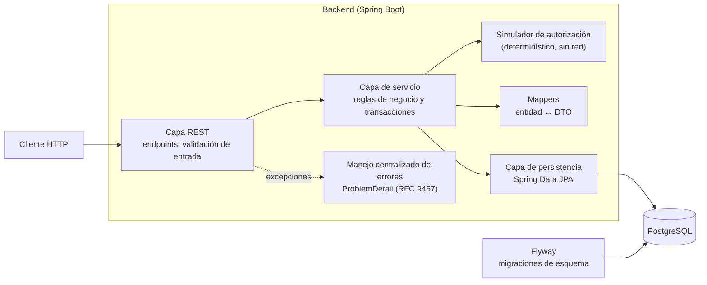
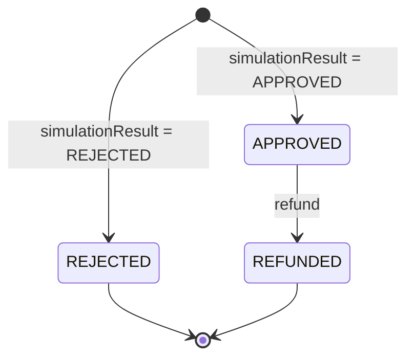
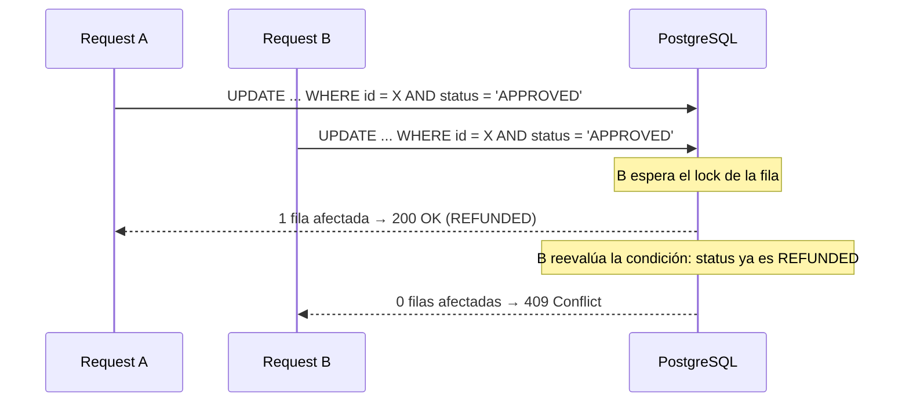
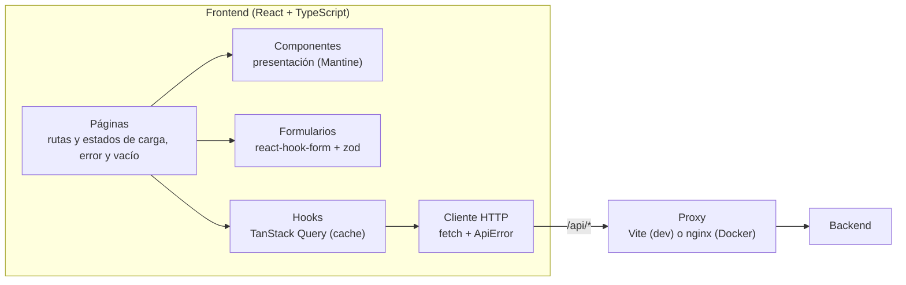

# Payment Manager

Aplicación para que un comercio registre pagos con autorización simulada, consulte sus transacciones y realice devoluciones totales.

- **Backend:** Java 21 + Spring Boot, PostgreSQL, Flyway.
- **Frontend:** React + TypeScript.

El repositorio tiene dos proyectos independientes:

```
payment-manager/
├── compose.yaml                # stack completo: PostgreSQL + API + frontend
├── payment-manager-api/        # API REST (Spring Boot, Maven) y su compose.yaml con PostgreSQL
└── payment-manager-frontend/   # SPA (React, Vite), servida con nginx en Docker
```

Cada proyecto tiene su propio build, configuración y `.gitignore`, como si estuvieran en repositorios separados.

**Bonus implementados:** idempotencia en la creación de pagos (`Idempotency-Key`), paginación del listado, Docker Compose con el stack completo, tests de integración y end-to-end (Playwright), y colección de Postman.

---

## Cómo iniciarlo

### Con Docker (todo junto)

Solo requiere Docker. Desde la raíz del repo:

```bash
docker compose up -d --build
```

| Servicio | URL |
|---|---|
| Frontend | http://localhost:3000 |
| API | http://localhost:8080 (Swagger en `/swagger-ui.html`) |
| PostgreSQL | `localhost:5433` |

Los puertos se cambian con `WEB_PORT`, `API_PORT` y `POSTGRES_PORT`. Para bajarlo: `docker compose down` (con `-v` también se borra la base).

Para desarrollo, cada proyecto se puede levantar por separado: ver [Backend](#backend) y [Frontend](#frontend).

## Cómo se conectan frontend y backend

El navegador siempre llama a `/api/*` en su mismo origen: en desarrollo lo redirige el servidor de Vite y en Docker, nginx. Así no hace falta CORS. El backend igual lo habilita solo para los orígenes configurados, por si alguien llama a la API directo desde otro origen. nginx reenvía el `Host` original para que el backend reconozca esos requests como del mismo origen.


---

## Backend

Proyecto en `payment-manager-api/`: Java 21, Spring Boot, PostgreSQL y Flyway.

### Arquitectura



El backend está organizado en tres capas:

- **REST:** expone los endpoints, valida la entrada y solo intercambia DTOs.
- **Servicio:** concentra las reglas de negocio y define los límites transaccionales.
- **Persistencia:** se ocupa únicamente del acceso a datos.

Las entidades JPA no salen de la capa de servicio. Los errores se traducen a respuestas HTTP en un único punto, con un formato uniforme.

### Ciclo de vida de un pago



- `REJECTED` y `REFUNDED` son estados finales.
- Solo un pago `APPROVED` puede devolverse, y una sola vez.

### Cómo Iniciarlo

#### Requisitos

- Java 21. `payment-manager-api`
- Docker y Docker Compose.

No hace falta instalar Maven: se usa el wrapper (`./mvnw`).

#### Pasos

```bash
cd payment-manager-api

# 1. Levantar PostgreSQL (puerto 5433 del host)
docker compose up -d

# 2. Levantar el backend (perfil local por defecto, puerto 8080)
./mvnw spring-boot:run
```

Al arrancar en local, Flyway crea el esquema y carga tres pagos de ejemplo (uno por cada estado final) para tener datos desde el primer momento.

Los datos se guardan en un volumen de Docker, así que sobreviven a reinicios del backend y del contenedor. Para empezar con la base vacía se puede usar `docker compose down -v`.

#### Configuración

Todo tiene valores por defecto pensados para local. Se pueden sobreescribir con variables de entorno:

| Variable | Default | Uso |
|---|---|---|
| `POSTGRES_HOST` | `localhost` | Host de la base |
| `POSTGRES_PORT` | `5433` | Puerto de la base |
| `POSTGRES_DB` | `payment_manager` | Nombre de la base |
| `POSTGRES_USER` | `payment_manager` | Usuario |
| `POSTGRES_PASSWORD` | `payment_manager` | Contraseña |
| `CORS_ALLOWED_ORIGINS` | `http://localhost:5173` | Orígenes del frontend habilitados (separados por coma) |

#### Documentación de la API

Con el backend levantado:

- **Swagger UI:** http://localhost:8080/swagger-ui.html
- **OpenAPI JSON:** http://localhost:8080/v3/api-docs

### API

| Método | Ruta | Descripción | Respuesta OK |
|---|---|---|---|
| `POST` | `/payments` | Crea un pago y lo autoriza con el simulador | `201 Created` |
| `GET` | `/payments` | Lista pagos (paginado, filtro opcional por estado) | `200 OK` |
| `GET` | `/payments/{id}` | Devuelve el detalle de un pago | `200 OK` |
| `POST` | `/payments/{id}/refund` | Devuelve el total de un pago aprobado | `200 OK` |

Ejemplos listos para usar en [`payment-manager-api/requests/`](payment-manager-api/requests): una colección de Postman, que se corre en orden y verifica cada respuesta, y [ejemplos con curl](payment-manager-api/requests/curl.md).

#### Crear un pago

```bash
curl -X POST http://localhost:8080/payments \
  -H "Content-Type: application/json" \
  -H "Idempotency-Key: 4f9c2a7e-1b3d-4c5e-8f6a-7b8c9d0e1f2a" \
  -d '{
        "merchantId": "COMMERCE_001",
        "amount": 15000,
        "currency": "ARS",
        "simulationResult": "APPROVED"
      }'
```

```json
{
  "id": "pay_3f1c9a52-7d0e-4b8a-9a3e-2c6f1b7d4e10",
  "merchantId": "COMMERCE_001",
  "amount": 15000.00,
  "currency": "ARS",
  "status": "APPROVED",
  "createdAt": "2026-10-14T20:15:00Z"
}
```

`simulationResult` (`APPROVED` | `REJECTED`) define el resultado de la autorización simulada. El pago se guarda con ese estado final.

El header `Idempotency-Key` es opcional. Ver [Creación idempotente](#creación-idempotente-con-idempotency-key).

#### Listar pagos

```bash
curl "http://localhost:8080/payments?status=APPROVED&page=0&size=20"
```

| Parámetro | Default | Descripción |
|---|---|---|
| `status` | (todos) | `APPROVED`, `REJECTED` o `REFUNDED` |
| `page` | `0` | Número de página (desde 0) |
| `size` | `20` | Tamaño de página (1 a 100) |

Los resultados se ordenan del más nuevo al más viejo.

> **Variante sobre el contrato sugerido:** el enunciado propone devolver un array. Como el listado está paginado, la respuesta es un objeto con los pagos en `content` y la metadata de paginación.

```json
{
  "content": [
    {
      "id": "pay_001",
      "merchantId": "COMMERCE_001",
      "amount": 15000.00,
      "currency": "ARS",
      "status": "APPROVED",
      "createdAt": "2026-10-08T15:00:00Z"
    }
  ],
  "page": 0,
  "size": 20,
  "totalElements": 1,
  "totalPages": 1
}
```

#### Detalle de un pago

```bash
curl http://localhost:8080/payments/pay_001
```

#### Devolución

```bash
curl -X POST http://localhost:8080/payments/pay_001/refund
```

Devuelve el pago actualizado con `"status": "REFUNDED"`.

#### Errores

Todos los errores usan el formato estándar **ProblemDetail (RFC 9457)**: título, detalle legible, código HTTP, ruta de la request y timestamp.

| Caso | HTTP |
|---|---|
| Datos inválidos: `amount` ≤ 0, `merchantId` vacío, moneda o `simulationResult` inválidos, JSON mal formado, parámetros de listado fuera de rango | `400 Bad Request` |
| Pago inexistente | `404 Not Found` |
| Devolver un pago `REJECTED` o ya `REFUNDED` | `409 Conflict` |
| Reutilizar una `Idempotency-Key` con otros datos | `422 Unprocessable Content` |
| `Idempotency-Key` que otro request está procesando | `409 Conflict` |
| Error inesperado (sin exponer detalles internos) | `500 Internal Server Error` |

Para los errores de entrada se eligió **400** en todos los casos, por consistencia. La excepción es el `422` de la `Idempotency-Key`, que sigue el estándar del header. Cuando la validación falla por campos, la respuesta incluye un mapa `errors` con el problema de cada campo:

```json
{
  "type": "about:blank",
  "title": "Validation failed",
  "status": 400,
  "detail": "Request has invalid fields",
  "instance": "/payments",
  "timestamp": "2026-10-14T20:15:00Z",
  "errors": {
    "amount": "amount must be greater than zero",
    "merchantId": "merchantId must not be blank"
  }
}
```

```json
{
  "type": "about:blank",
  "title": "Payment cannot be refunded",
  "status": 409,
  "detail": "Payment with id 'pay_002' cannot be refunded because its status is REJECTED",
  "instance": "/payments/pay_002/refund",
  "timestamp": "2026-10-14T20:15:00Z"
}
```

### Reglas de negocio

1. El importe debe ser estrictamente mayor a cero, con hasta 2 decimales.
2. La moneda es obligatoria. `ARS` está soportada, junto con otras monedas de la región y algunas internacionales.
3. `merchantId` es obligatorio y no puede estar vacío.
4. La autorización es interna y determinística: no hay red, terceros ni asincronía.
5. Cada pago recibe un id único (`pay_` + UUID) y una fecha de creación en UTC.
6. Solo los pagos `APPROVED` pueden devolverse, y la devolución es total.
7. Un pago no puede devolverse más de una vez. Un refund fallido (pago rechazado o ya devuelto) no modifica la operación.

### Decisiones técnicas

#### Refund atómico y seguro ante concurrencia

Si dos refunds llegan al mismo tiempo sobre el mismo pago, solo uno puede tener éxito. En lugar de leer el estado, validarlo en memoria y después guardar (con una ventana de carrera entre ambos pasos), la transición se hace con un **UPDATE condicional**:

```sql
UPDATE payments SET status = 'REFUNDED' WHERE id = ? AND status = 'APPROVED'
```

- La base toma un lock de fila. El segundo UPDATE espera a que termine el primero, reevalúa la condición y ya no encuentra el pago en `APPROVED`, así que afecta 0 filas.
- Según la cantidad de filas afectadas, el servicio responde `200` o `409`. Para distinguir un `404` de un `409`, consulta el estado actual del pago.



Se eligió esta opción frente a otras dos:

- **Locking optimista con `@Version`:** el perdedor recibe una excepción que hay que traducir, y suma una columna.
- **Lock pesimista (`SELECT ... FOR UPDATE`):** mantiene el lock durante toda la lógica.

El UPDATE condicional es una sola sentencia y no deja ninguna ventana de carrera. Lo cubre un test de integración que dispara varios refunds en paralelo y verifica que exactamente uno tenga éxito. También se probó manualmente con dos instancias del backend sobre la misma base.

#### Creación idempotente con `Idempotency-Key`

`POST /payments` acepta el header opcional `Idempotency-Key` para que reintentar un request cuya respuesta se perdió no cree un pago duplicado. Junto a la key se guarda un hash SHA-256 del request (*idempotency fingerprint*), para distinguir un reintento real de una key reutilizada con otros datos.

| Caso | Respuesta |
|---|---|
| Misma key, mismos datos | Devuelve el pago ya creado (`201`) |
| Misma key, otros datos | `422` |
| Misma key mientras otro request con esa key se está procesando | `409` |

La key, el hash y el pago que creó se guardan en la tabla `payment_idempotency_keys`, en la misma transacción que el pago, así que la operación es atómica. La key es la clave primaria: si dos requests con la misma key llegan a la vez, solo uno puede guardarla.

Fuentes: [IETF draft *The Idempotency-Key HTTP Header Field*](https://datatracker.ietf.org/doc/html/draft-ietf-httpapi-idempotency-key-header) (secciones 2.4 y 2.7) y [Stripe, *Idempotent requests*](https://docs.stripe.com/api/idempotent_requests).

#### Montos con `BigDecimal`

Los importes se manejan como `BigDecimal` y se guardan como `NUMERIC(19, 2)`, para evitar los errores de redondeo de `double`.

#### Esquema versionado con Flyway

- El esquema se define con migraciones SQL versionadas, y Hibernate solo valida que las entidades coincidan con él (nunca genera ni modifica tablas).
- Flyway corre solo en local y en los tests. En otros entornos el esquema se gestionaría por fuera de la aplicación.
- La base también aplica las reglas críticas con constraints: importe positivo y estados válidos.
- Hay índices compuestos para el listado más común (ordenado por fecha, con y sin filtro por estado).
- Los datos de ejemplo están en una carpeta separada que solo se carga en el entorno local, así que los tests arrancan siempre con la base vacía.

#### Paginación

El listado está paginado desde el principio, con un tamaño máximo de página, para que la respuesta no crezca sin límite a medida que se acumulan pagos.

### Testing

```bash
cd payment-manager-api
./mvnw clean verify   # tests unitarios + de integración
./mvnw test           # solo unitarios
```

- **Unitarios:** cubren la capa de servicio con colaboradores mockeados, la capa REST (códigos HTTP y formato de errores), el simulador, los mappers y las validaciones de entrada.
- **Integración:** levantan la aplicación completa contra H2 en memoria en modo compatible con PostgreSQL. El esquema lo crean las mismas migraciones de Flyway que en local. Hay una clase por caso de uso: crear, consultar, listar y devolver.
- **Estilo:** BDD. Los nombres de los tests siguen `given_when_then` y tienen una descripción legible.

Los cinco casos obligatorios del enunciado están cubiertos:

1. Creación de un pago aprobado.
2. Creación de un pago rechazado.
3. Devolución exitosa de un pago aprobado.
4. Devolución de un pago ya devuelto: falla con `409`.
5. Devolución de un pago rechazado: falla con `409`.

En los casos de fallo, los tests no solo validan el código HTTP: también verifican en la base que **el estado del pago no cambió**. Además, hay un test de concurrencia que lanza varios refunds simultáneos sobre el mismo pago.

---

## Frontend

SPA en `payment-manager-frontend/` que consume la API del backend.

- **Stack:** React + TypeScript (strict), Vite, Mantine (componentes y estilos), TanStack Query (estado del servidor), React Router y react-hook-form + zod (formularios).
- **Testing:** Vitest + Testing Library, con la red mockeada por MSW, y Playwright para los e2e.

### Arquitectura



El código está organizado por feature, con dependencias en una sola dirección:

- **Páginas:** leen la URL, llaman a los hooks y componen la vista.
- **Hooks:** envuelven cada endpoint en una query o mutación de TanStack Query y mantienen la cache al día.
- **Componentes:** solo presentan datos recibidos por props.
- **Cliente HTTP:** hace los requests a rutas relativas `/api/*` y convierte cualquier falla en un único `ApiError`.

### Pantallas

- **Listado de pagos (`/payments`):** tabla paginada con filtro por estado.
- **Detalle de un pago (`/payments/:id`):** todos los datos del pago. Si el pago está `APPROVED`, ofrece la devolución, que pide confirmación antes de ejecutarse.
- **Nuevo pago (`/payments/new`):** formulario con validación en el cliente. Al crearlo, notifica si fue aprobado o rechazado y abre su detalle.

### Cómo iniciarlo

Requiere Node 24. Con el backend levantado:

```bash
cd payment-manager-frontend
npm install
npm run dev   # http://localhost:5173
```

#### Configuración

En desarrollo, el navegador llama a rutas relativas `/api/*`. El servidor de Vite las redirige al backend y quita el prefijo `/api`, así que la URL del backend nunca queda escrita en el código.

| Variable | Default | Uso |
|---|---|---|
| `API_PROXY_TARGET` | `http://localhost:8080` | Backend al que el dev server redirige `/api/*` |

### Decisiones técnicas

- **Organización por feature:** cada feature (`features/payments`) agrupa sus páginas, componentes, hooks y query keys. La dependencia va siempre en una dirección: páginas → hooks → capa de API. Los componentes de presentación solo reciben datos por props.
- **Un único tipo de error:** el cliente HTTP convierte toda falla (respuesta `ProblemDetail` o error de red) en un `ApiError` con el status, el mensaje para el usuario y los errores por campo. El resto de la app maneja los errores de una sola forma.
- **Estado del servidor en TanStack Query:** no hay store global. Los datos del backend viven en la cache de queries. Los reintentos son solo para errores de red o `5xx`, nunca para `4xx`.
- **Filtros y paginación en la URL:** el estado y la página se guardan en los query params (`?status=APPROVED&page=2`). Así el listado se puede recargar, compartir y navegar con atrás/adelante. Los valores inválidos de la URL se ignoran.
- **Validación en dos niveles:** el formulario valida con zod las mismas reglas que el backend, para dar feedback inmediato sin hacer el request. Si igual el backend rechaza un campo, el error se muestra al lado de ese campo. Los errores sin campo asociado se muestran como mensaje general del formulario.
- **Devolución:** el botón solo aparece para pagos `APPROVED` y pide confirmación, porque la acción es irreversible. Si el backend responde `409` (por ejemplo, porque el pago se devolvió desde otra pestaña), se muestra el motivo y se vuelve a consultar el pago para reflejar su estado real.
- **Creación idempotente:** el formulario manda un `Idempotency-Key` y lo reutiliza si el usuario reenvía los mismos datos después de un error.
- **Cache consistente:** después de crear o devolver un pago, el detalle se actualiza con la respuesta del backend y el listado se invalida, así que nunca muestra datos viejos.
- **Estados explícitos:** cada vista maneja carga, error (con opción de reintentar) y vacío. El detalle de un pago inexistente muestra un estado "no encontrado".
- **Monedas en el formulario de creación:** el backend solo acepta un conjunto cerrado de monedas, así que el formulario las ofrece en un select en lugar de un campo libre. De esta forma no se puede elegir una moneda inválida. La lista está duplicada en el frontend por simplicidad. En un caso real, las monedas soportadas se obtendrían del backend (por ejemplo, con un endpoint `GET /currencies`) o de un servicio externo, para no tener que actualizar el frontend cada vez que se agrega una.

### Testing

```bash
cd payment-manager-frontend
npm run test    # tests unitarios y de componentes
npm run lint    # ESLint
npm run build   # chequeo de tipos y build de producción
```

Tests end-to-end con Playwright, contra el stack de Docker levantado:

```bash
npx playwright install chromium   # solo la primera vez
npm run test:e2e
```

- Los tests de páginas renderizan las rutas reales y simulan la interacción como un usuario (clicks, navegación).
- La red se mockea con MSW a nivel HTTP: no se mockean `fetch`, la capa de API ni los hooks. Cualquier request sin handler hace fallar el test.
- Se usa el mismo estilo BDD que en el backend: los nombres siguen `given / when / then`.

---

## Uso de Inteligencia Artificial

**Herramienta:** Claude Code

**Cómo lo usé:**

- Lo usé para investigar y para la gfeneración de código
- Definí las convenciones de cada proyecto en archivos `CLAUDE.md` (arquitectura en capas, BDD, manejo de errores, organización del frontend) para que el código generado las siga y lo fuí actualizando a medida que surgieron nuevas convenciones

**Decisiones propias sobre lo generado:**

- UI: la IA arrancó con Tailwind + shadcn; lo cambié por Mantine.

- Transacciones: la IA puso @Transactional en las consultas de solo lectura. Lo cuestioné porque no había nada que deshacer y quedó solo en create y refund.
- Datos que se adelantaban: la IA agregó cambios en PR que no eran necesarios, rompiendo al restricción de crear PR chicos con solo lo necesario
- Idempotencia: la IA guardaba las keys en columnas de payments. Las moví a una tabla propia para que el pago solo tenga datos del negocio. Además, pedí fuentes antes de aceptar el diseño y, al revisarlas, cambié el error de una key reutilizada de 409 a 422, como recomienda el draft del IETF.
- Tests: pedí que los tests del backend usen @DisplayName para que se lean como casos de uso, y que los e2e queden separados por caso de uso (createPayment, listPayments, refundPayment).
- Proceso: reduje el plan de PRs que propuso la IA a menos PRs y más cohesivos.

**Cómo verifiqué:**

- Lint, tests, build y formato en cada PR, antes de commitear.
- Tests e2e con Playwright contra el stack real, sin mocks.
- Pruebas manuales contra PostgreSQL: requests concurrentes de refund e idempotencia, y la colección de Postman.

**Limitaciones y problemas encontrados:**

- Sin limitaciones teniendo en cuenta que no es una versión productiva.
- No se encontraron problemas
